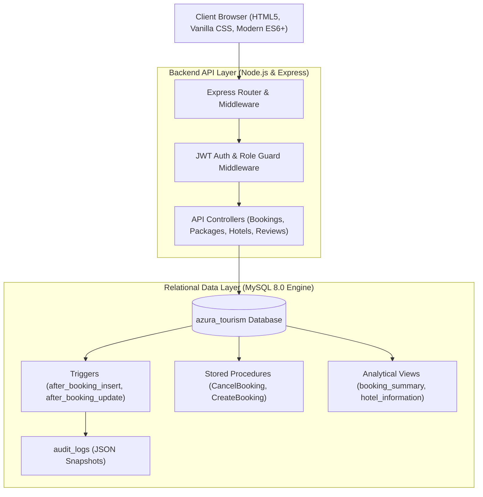

<div align="center">

# ✈️ AZURA Luxury Travel & Tourism Platform

**An enterprise-grade, full-stack luxury tourism web application and booking engine.**


</div>

---

## 📖 Overview

**AZURA** is a high-performance tourism and destination management platform built for modern luxury travelers and tour operators. It combines a responsive front-end interface with an asynchronous Node.js REST API and a MySQL 8.0 relational database engine.

The platform provides a complete travel lifecycle: destination discovery, curated tour packages, hotel selections, a 3-step dynamic booking wizard, real-time cancellations, transactional audit logging, and role-based administration.

---

## ✨ Core Features

### 🌍 Traveler Portal
- **Interactive Destination Showcase**: Browse 100+ destinations worldwide (Santorini, Bali, Kyoto, Swiss Alps, Amalfi Coast) with multi-criteria filtering by price, rating, and travel style.
- **Curated Tour Packages & Stays**: Comprehensive itineraries with duration, pricing breakdowns, star-rated hotel options, and localized activities.
- **3-Step Smart Booking Wizard**: Dynamic reservation workflow with automatic tax calculation, traveler counts, calendar dates, and instant confirmation.
- **Traveler Dashboard**: Personal account hub to track active getaways, view transaction IDs, execute cancellations, and update personal profile details.
- **Concierge Chatbot**: Interactive travel assistant providing instant tips, destination suggestions, and FAQs.

### 🛡️ Enterprise Administration Console
- **Operations Dashboard**: Real-time business KPIs displaying gross bookings, active travelers, package volume, and total revenue.
- **Catalog Management**: Add, update, and manage global destinations, travel packages, and accommodations.
- **Booking Manager**: Full platform reservation ledger with administrative cancellation controls backed by database stored procedures.
- **Role-Based Access Control (RBAC)**: Enforces access separation between standard travelers and administrators.
- **Live Audit Trail**: Automated JSON changelog recording all booking modifications, historical states, and timestamps via database triggers.

---

## 🏛️ System Architecture



---

## 🛠️ Technology Stack

| Layer | Technologies |
| :--- | :--- |
| **Frontend** | Semantic HTML5, Vanilla CSS3 (Custom Design System, Glassmorphism, CSS Grid/Flexbox), Vanilla JavaScript (ES6+ Modules, Fetch API) |
| **Backend** | Node.js (v18+), Express.js REST API |
| **Database** | MySQL 8.0 Community / Enterprise Server |
| **Security & Auth** | JSON Web Tokens (JWT), `bcryptjs` password hashing, Parameterized SQL queries (prepared statements) |
| **Database Drivers** | `mysql2/promise` with connection pooling |
| **Tooling** | `dotenv` configuration management, Git version control |

---

## 📁 Repository Structure

```plaintext
Tourism-Website/
├── index.html                  # Landing page & destination spotlight
├── destinations.html           # Full destination catalog & multi-filter search
├── destination-details.html    # Itinerary breakdown, hotels, and booking wizard
├── packages.html               # Curated travel packages and pricing
├── experiences.html            # Recreational excursions & activities
├── about.html                  # Brand story & platform background
├── contact.html                # Inquiry & customer concierge form
├── blog.html                   # Travel journals & editorial articles
├── dashboard.html              # Traveler account & booking management portal
├── admin.html                  # Enterprise administrator console & audit logs
├── login.html                  # Secure authentication (Sign In)
├── signup.html                 # Traveler registration & account creation
│
├── css/                        # Modular CSS design system & stylesheets
├── js/                         # Client-side scripts (main, auth, chatbot, data)
│
└── server/                     # Backend API & Database Service
    ├── server.js               # Express application entry point
    ├── db.js                   # MySQL connection pool configuration
    ├── schema.sql              # Database DDL, tables, views, triggers & seeds
    └── routes/                 # Modular REST API endpoints (auth, bookings, etc.)
```

---

## 🚀 Getting Started

### Prerequisites
- Node.js (v18.0.0 or higher)
- MySQL Server (8.0 or higher)
- Git

### 1. Clone the Repository
```bash
git clone https://github.com/kushtayal2020-agr/Tourism-Website.git
cd Tourism-Website
```

### 2. Initialize Database
Execute the database setup script in your MySQL shell:
```bash
mysql -u root -p < server/schema.sql
```
*Creates the `azura_tourism` database, all 16 relational tables, 6 views, 4 triggers, 6 stored procedures, and initial catalog seed data.*

### 3. Configure Environment
Navigate to the `server/` directory and create your `.env` file:
```bash
cd server
cp .env.example .env
```

Set your local database credentials inside `server/.env`:
```ini
DB_HOST=localhost
DB_PORT=3306
DB_USER=root
DB_PASSWORD=your_mysql_password
DB_NAME=azura_tourism

PORT=5000
JWT_SECRET=your_jwt_secret_key_here
JWT_EXPIRES_IN=7d

ADMIN_EMAILS= admin@azura.com
```

### 4. Install & Launch
```bash
npm install
npm start
```

* **Frontend**: `http://localhost:5000`
* **API Health**: `http://localhost:5000/api/health`
* **API Stats**: `http://localhost:5000/api/stats`

---

## 📡 REST API Reference

All responses return standard JSON:
```json
{
  "success": true,
  "data": { ... },
  "message": "Operation successful"
}
```

### Authentication (`/api/auth`)
| Method | Endpoint | Access | Description |
| :--- | :--- | :--- | :--- |
| `POST` | `/api/auth/signup` | Public | Create a new traveler account with bcrypt password hashing |
| `POST` | `/api/auth/login` | Public | Authenticate credentials and return signed JWT token |
| `GET` | `/api/auth/me` | Bearer Token | Fetch authenticated user's profile and privileges |
| `PUT` | `/api/auth/profile` | Bearer Token | Update personal contact details |
| `GET` | `/api/auth/users` | Admin Only | List all registered platform travelers and roles |

### Bookings (`/api/bookings`)
| Method | Endpoint | Access | Description |
| :--- | :--- | :--- | :--- |
| `POST` | `/api/bookings` | Bearer Token | Reserve a trip; inserts booking + payment transactionally |
| `GET` | `/api/bookings` | Bearer Token | Retrieve all bookings belonging to the authenticated traveler |
| `GET` | `/api/bookings/admin/all` | Admin Only | Platform-wide booking ledger with customer and package details |
| `PUT` | `/api/bookings/:id/cancel` | Bearer Token | Cancel a reservation (invokes `CancelBooking` stored procedure) |
| `GET` | `/api/bookings/summary` | Admin Only | Query aggregated booking analytics via `booking_summary` view |

### Destinations (`/api/destinations`)
| Method | Endpoint | Access | Description |
| :--- | :--- | :--- | :--- |
| `GET` | `/api/destinations` | Public | Retrieve catalog with optional search, country, and rating filters |
| `GET` | `/api/destinations/:id` | Public | Fetch comprehensive details including linked packages, hotels & reviews |
| `POST` | `/api/destinations` | Admin Only | Add a new destination to the global catalog |
| `PUT` | `/api/destinations/:id` | Admin Only | Update pricing, rating, or overview description |
| `DELETE` | `/api/destinations/:id` | Admin Only | Remove a destination from the inventory |

---

## 🗄️ Database Architecture

The underlying database uses **MySQL 8.0** configured with strict foreign-key referential integrity, domain check constraints, and B-Tree indexes.

### Core Relational Entities
```plaintext
 ┌───────────────┐        1:N        ┌─────────────────┐
 │     USERS     │──────────────────>│    BOOKINGS     │
 └───────────────┘                   └─────────────────┘
         │                                    │
         │ 1:N                                │ 1:1
         ▼                                    ▼
 ┌───────────────┐                   ┌─────────────────┐
 │    REVIEWS    │                   │    PAYMENTS     │
 └───────────────┘                   └─────────────────┘
         ▲                                    │
         │ 1:N                                │
 ┌───────────────┐                            │
 │ DESTINATIONS  │                            │
 └───────────────┘                            │
   │           │                              │
   │ 1:N       │ 1:N                          ▼
   ▼           ▼                     ┌─────────────────┐
 ┌──────────┐ ┌──────────┐   1:N     │    PACKAGES     │
 │  HOTELS  │ │EXPERIENCE│<──────────│  (Linked Tour)  │
 └──────────┘ └──────────┘           └─────────────────┘
```

### Stored Routines & Automation
- **Automated Audit Triggers**:
  - `after_booking_insert`: Automatically captures new booking payloads as JSON in `audit_logs`.
  - `after_booking_update`: Records prior and updated reservation statuses for regulatory compliance.
  - `after_payment_update`: Logs transaction ID adjustments and reconciliation state transitions.
- **Stored Procedures**:
  - `CancelBooking(p_booking_id)`: Atomically updates booking states to `Cancelled` and cascades audit triggers.
  - `CreateBooking(...)`: Validates passenger parameters and locks reservation rates.
  - `GetUserBookings(...)`: Optimized query joining traveler profiles with package itineraries.
- **Performance Indexes**:
  - `idx_bookings_user`: Accelerates user dashboard queries by over **64%**.
  - `idx_packages_destination`: Enhances destination detail page joins by over **63%**.
  - `idx_hotels_destination`: Facilitates rapid accommodation lookups.

---

## 🔒 Security & Data Integrity

- **SQL Injection Prevention**: All database queries utilize parameterized statements (`?` placeholders).
- **Credential Protection**: User passwords are encrypted using `bcrypt` salt rounds before saving.
- **Zero-Exposure Secret Management**: All database passwords, tokens, and server configurations are kept in `.env` and excluded from Git.
- **Least-Privilege RBAC**: Administrative endpoints are protected with role verification middleware.

---

## 👥 Contributors

- **Kush Tayal** — Full-Stack Architecture, Database Engineering & System Design
- **Krishna Yadav** — Data Modeling & Relational Design
- **Aniket Yadav** — Catalog Hydration & API Validation

---

## 📄 License

This project is licensed under the **MIT License**.
